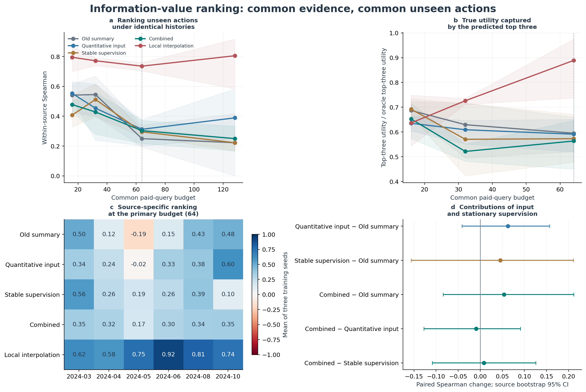
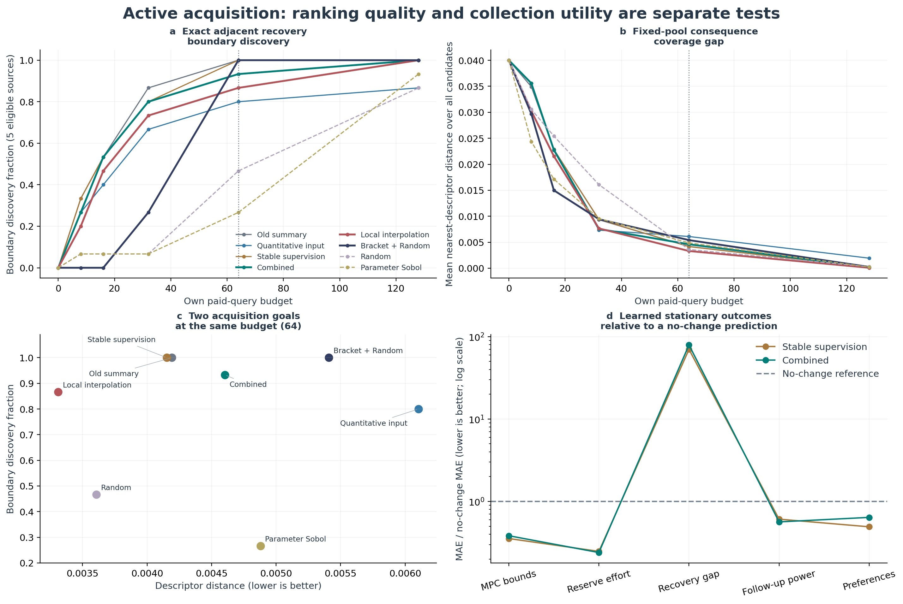

# 定量经验与稳定后果监督：零新仿真验证

本轮回答一个具体问题：采集器是否真正知道“下一次查询哪个动作更有信息价值”？复用162条已存在的分支、486组MPC测量；18条参考与端点分支为共同初始经验，144条中间动作构成付费查询池。新增物理仿真、LP求解、旧RL/预警器/专家训练全部为零。正式训练仅为24个新采集评分器，三种子42/43/44，CPU串行完成。

## 同历史排序：主要结果

四种模型读取相同Random历史，面对完全相同的未查候选。64次查询之后还有80条候选。排序真值、22维后果画像和信息奖励均沿用原定义。Spearman先在每个source内部计算，再平均三种子及source。top3捕获率衡量模型前三名实际获得的效用占真实最优前三名的比例；遗憾越小越好。

| 配置 | Spearman | Top3真实效用捕获 | Top3平均遗憾 | 三种子Spearman |
| --- | --- | --- | --- | --- |
| 旧摘要 | 0.250 | 59.5% | 0.0367 | 0.193 / 0.340 / 0.215 |
| 空间＋定量经验 | 0.312 | 59.1% | 0.0363 | 0.377 / 0.358 / 0.202 |
| 稳定后果监督 | 0.295 | 57.3% | 0.0388 | 0.265 / 0.319 / 0.302 |
| 两者结合 | 0.303 | 56.3% | 0.0393 | 0.321 / 0.372 / 0.217 |
| 局部物理插值 | 0.736 | 88.9% | 0.0180 | 0.760 / 0.704 / 0.744 |


两者结合相对旧摘要的排序改善0.054，95% source配对区间为[-0.084, +0.212]；source配对区间仍包含零，不能将平均变化解释为稳定增益。局部插值以同一份已查询经验做对照，直接检验连续后果是否已经足以推算邻近动作的信息价值。



图1a–b比较同历史排序与前三项效用，淡色带为三个训练种子的范围；c展示每个source是否都改善，d给出source配对区间。128预算后每个source只剩2–3个候选，top3必然包括全部候选，因此b面板不展示这一失去区分度的点。

| 配对比较 | Spearman变化 | 95% source CI | source数 |
| --- | --- | --- | --- |
| 空间＋定量经验 − 旧摘要 | +0.063 | [-0.041, +0.157] | 6 |
| 稳定后果监督 − 旧摘要 | +0.046 | [-0.157, +0.211] | 6 |
| 两者结合 − 旧摘要 | +0.054 | [-0.084, +0.212] | 6 |
| 两者结合 − 空间＋定量经验 | -0.009 | [-0.127, +0.091] | 6 |
| 两者结合 − 稳定后果监督 | +0.008 | [-0.108, +0.126] | 6 |
| 两者结合 − 局部物理插值 | -0.432 | [-0.543, -0.322] | 6 |


## 主动采集：排序能否转化为覆盖

这一协议让各评分器根据自己的已查询历史采集128次，每次25%随机探索，其余按双critic最小评分选动作。各方法候选池、初始18条经验与source轮询保持相同。下表是新增64次查询时的结果；边界率只在五个确实存在边界的source上平均。画像距离的分母是完整144候选池，每项到最近已知画像的距离取平均，已查询候选的距离为0；它不是只在剩余80项上的平均。各source各含24项，先计算各自距离再平均。括区＋Random复用原冻结查询记录。

| 方法 | 相邻恢复边界定位率 | 固定候选池画像距离↓ | 转折形态覆盖 |
| --- | --- | --- | --- |
| 旧摘要 | 100.0% | 0.004192 | 94.4% |
| 空间＋定量经验 | 80.0% | 0.006105 | 94.4% |
| 稳定后果监督 | 100.0% | 0.004152 | 94.4% |
| 两者结合 | 93.3% | 0.004602 | 94.4% |
| 局部物理插值 | 86.7% | 0.003311 | 94.4% |
| 括区＋Random | 100.0% | 0.005409 | 91.7% |
| Random | 46.7% | 0.003607 | 97.2% |
| 参数空间Sobol | 26.7% | 0.004879 | 100.0% |




图2a–b分别考查定位边界和覆盖连续画像；两项任务不等价。c将64预算的两项结果放到一个坐标系，d以“不发生相对参考变化”的零预测为基准，检查稳定后果头的误差。纵坐标小于1表示优于零预测，恢复缺口则明显高于1，揭示稀少边界量尚未学好。组合模型的画像距离0.004602也没有优于旧摘要0.004192，不能把平均相关的小幅提高写成已实现的采集增益。

## 最重要的诊断：学后果与学一个Q值存在差别

在不增加任何训练的情况下，直接复用稳定后果头的已冻结预测，将预测的调度上下界与储能恢复努力变换成后果画像，再显式计算原信息奖励。恢复状态采用本缓存已核验吻合的1小时能量/功率必要边界，不采用该模型误差较大的直接缺口回归。排序相关从同一模型Q评分的0.295提高到0.514。配对提升0.219，95% source区间[0.022, 0.423]。与旧摘要相比提高0.265，区间[0.050, 0.529]。这一比较保持模型预测不变，改变物理投影与价值读出方式，支持：已经学到的一部分后果结构，没有被直接的价值评分充分利用。

| 冻结模型与读出方式 | 排序Spearman | Top3真实效用捕获 |
| --- | --- | --- |
| 旧摘要Q评分 | 0.250 | 59.5% |
| 稳定后果监督Q评分 | 0.295 | 57.3% |
| 稳定后果预测→显式计算价值 | 0.514 | 71.3% |
| 两者结合Q评分 | 0.303 | 56.3% |
| 两者结合预测→显式计算价值 | 0.389 | 61.3% |
| 局部物理插值 | 0.736 | 88.9% |


显式计算后，稳定模型前三项效用捕获也从57.3%升至71.3%，但这项提升的source区间仍跨零。0.514仍低于局部物理插值的0.736；该二级诊断尚未接入新的主动查询策略，不将它冒充主动采集胜出。

| 固定后果组 | 稳定模型MAE | 零变化MAE | 模型/零变化误差 |
| --- | --- | --- | --- |
| MPC功率上下界 | 0.006383 | 0.017990 | 0.35 |
| 参考储能恢复努力 | 0.042120 | 0.169965 | 0.25 |
| 恢复缺口 | 0.003325 | 0.000048 | 69.96 |
| 后续控制功率 | 0.009476 | 0.015545 | 0.61 |
| 后续偏好 | 0.003054 | 0.006200 | 0.49 |


上下界、恢复努力、后续控制和偏好的误差均低于零变化预测，说明稳定后果监督确实学习了行动对后续资源及调度的影响。恢复缺口恰好相反：大量零缺口与极少数小的正缺口使平均回归没有准确表达临界边界。三种子64预算的80条剩余候选中，存在正恢复缺口的分支数分别为2、1、0；端点是共同初始经验，剩余候选中的正例尤其稀少。这是下一步需要针对的学习对象，而非继续增加输入维数或网络宽度。

## 研究判断与下一步

第一，补齐输入带来部分source的排序改善，但既没有稳定的整体增益，也没有改善最优先查询的少数动作；空间和定量经验通道本身不足以解决问题。第二，稳定后果能被学习，其价值在“预测后果→依据当前已知经验计算信息价值”的分工中更清楚；把随经验库变化的价值直接交给一个Q标量，是当前最值得替换的环节。第三，局部插值利用相同经验即取得很强结果，说明当前两条剂量路径上应先保留可解释的物理计算，学习模块应争取补足插值不确定的转折与边界。

下一版可保持本轮稳定后果模型不变，在原缓存内先检验显式价值读出的主动采集，再把边界两侧的参考储能恢复余量作为成对判别任务。保留括区＋Random负责边界定位，局部插值负责平滑区段；仅在两者分歧或预测后果接近恢复边界时调用学习评分。该方向由本轮数据指向，尚未新增执行。

## 实现含义与可复核边界

空间输入补入各节点V/P/Q、逐站需求/期限/充放电能力、上次功率与可见到达预测；所有缩放只使用初始参考状态。定量经验保留同状态下已查询的相邻上下动作、最近动作的固定60维后果和22维画像，未查询的真实后果只能在选中并支付一次查询后进入训练。

稳定监督学习三个未来时刻（+1/+3/+5h）的MPC可行功率上下界、参考储能恢复所需努力、恢复缺口、后续控制请求和偏好变化。该60维量可重建全部162条分支的原画像，误差不超过1e-10。辅助头只读状态与动作，既不读取当前经验库，也不改变原奖励。四格使用相同双128层及相同参数总数；旧配置把新增输入通道置零。

局部插值只使用同状态同动作族已查询的相邻剂量，并依据1小时、1MW充电率和0.95效率的资源边界重建恢复状态。本缓存中这一必要能量下界与已有LP缺口恰好一致，因此它是强物理对照；它并不替代一般网络约束下的联合可恢复性检验。本轮是相同六个历史source上的开发复用验证，三种子不是十八个独立物理source。

## 执行与数据

运行目录：`D:\博士资料包\科研\科研\AAAI_RL\tarp_37_information_acquisition\artifacts\acquisition_evidence_v3\evidence_formal_s42_v1`。全部候选评分、真值、固定后果预测、各source统计和checkpoint已保存；`source_records.json`和`analysis.json`可直接复算。原始输入与旧代码/旧checkpoint共465项文件哈希前后核对一致。

```powershell
Set-Location -LiteralPath 'D:\博士资料包\科研\科研\AAAI_RL\tarp_37_information_acquisition'
powershell -ExecutionPolicy Bypass -File .\scripts\run_acquisition_evidence_v3.ps1 -Mode formal -RunId evidence_formal_s42_v1 -Resume
```

相同RunId加`-Resume`用于核验和跳过已完成任务，不能用同一RunId更改配置。新完整重复实验请另设RunId。
