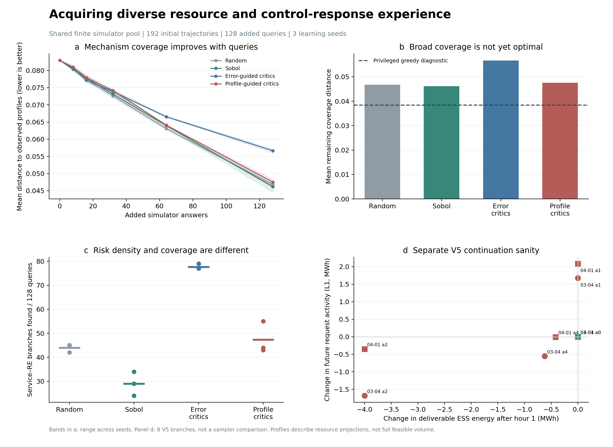

# 信息采集首轮对照：资源能力与控制响应画像

本轮只实施采集学习与物理接续核验，风险预警器、专家、融合和旧RL训练均为0。新采集学习器在CPU上训练，pilot为两种目标×3seed共6次，另有smoke两次。原V4/V5代码及硬件保持不变。



## 主要结果

| 方法 | 剩余覆盖距离↓ | 较初始经验下降 | Service–RE发现数 | 延迟Service发现数 |
|---|---:|---:|---:|---:|
| Random | 0.04679 | 43.6% | 44.0/128 | 10.3/128 |
| Sobol | 0.04617 | 44.4% | 29.0/128 | 13.7/128 |
| Error-guided critics | 0.05664 | 31.8% | 77.7/128 | 4.3/128 |
| Profile-guided critics | 0.04751 | 42.7% | 47.3/128 | 10.0/128 |


以上为3seed均值。距离以同一384条历史新增候选的完整机制画像为固定评价全集，初始192条经验另列。原始数据来自6个训练source、12个物理初态和24个偏好情境；它是共享有限缓存上的新增答案揭示实验，不是全新source或连续动作域证明。历史建库为192+384条轨迹，本次每臂另计128次答案访问。

机制画像驱动相对误差驱动的覆盖改进值得保留；但当前没有稳定超过random/Sobol，说明仅将奖励换成已知画像距离还不足以构成高效采集策略。误差驱动更倾向于获得Service–RE正例，而不一定覆盖更多不同响应。两者回答的是不同问题。

## 画像及采集接口

画像由未来各小时ESS可放/可吸能量、下小时可放/可充功率、备用余量，以及后五小时MPC请求和偏好组成，三组按固定物理标尺平衡。风险标签、损失、等待、弃发严重度不参与画像。当前是资源方向投影和控制响应，未计算完整网络—服务可行域。

采集器只获得49维当前可见状态与51维归一化候选动作；选中之后Oracle才揭示未来画像、误差效用和标签。风险侧效用由同一冻结V4初始模型只读前向获得。两学习臂采用相同双critic、预热和更新预算，25%探索，唯一主要变化是奖励。它是TD3式critic引导的有限池上下文采集，连续actor虽有更新但不用于本轮候选选取。

新颖性随已揭示集合变化，replay按当前同情境集合重算并排除自身；未知画像不补零。Sobol将新低差异点映射到同情境最近未查询候选，random同池均匀。所有方法使用共同情境访问顺序。事后贪心诊断使用全库未来画像，剩余距离为0.03842；它有特权信息，仅用于衡量差距，不能作为可部署方法。

## 来源统计

以source为单位，将3seed结果先平均，再对6source配对bootstrap 2000次。下列正差表示机制画像目标剩余距离更小。训练seed变化与source置信区间分开记录。

相对Error-guided critics：距离下降0.00913，95% CI [0.00572, 0.01208]。

相对Random：距离下降-0.00072，95% CI [-0.00197, 0.00042]。

相对Sobol：距离下降-0.00134，95% CI [-0.00442, 0.00083]。

## V5真实接续小验证

从两个V4保存的train初态出发，分别执行参考、限充、释放资源和一个Sobol动作，按V5常规有界Q实际演化六小时。8条分支、48小时全部AC核验有效；Voltage已确认正例0、未知0，Service–RE共同事件1条。该小实验用于接续和接口验证，不作为采集器优胜证据，也不代表已解决全量188小时数值未知或175小时反送边界。

每小时核验节点平衡、电压、线路、储能及备用边界、车辆和ESS能量守恒。多初始化仅在原Q求解失败后尝试pf初始化，约束和容差不变。反送许可仍单列，数值失败仍未知。保存每步决策时view及完整物理记录，后续可进一步计算正常服务调度域。

## 下一步

这一轮已把“更多危险后果”与“更丰富机制经验”分开量化。更值得做的定向改进是将当前资源方向投影升级为带期限、网络和正常处置预算的可调能力指标，并采集相近动作在恢复边界两侧的对照；预警器仍可暂缓。避免只最大化损害或画像变化。本文未在看到结果后改阈值、删seed或重选运行。

## 执行命令

```powershell
Set-Location -LiteralPath 'D:\博士资料包\科研\科研\AAAI_RL\tarp_37_information_acquisition'
powershell -NoProfile -ExecutionPolicy Bypass -File .\scripts\run_information.ps1 -Mode pilot -RunId information_pilot_v1 -Resume
```

已有运行的Resume核验并复用结果；新实验使用新RunId。V5原始记录位于artifacts/native_information/v5_information_sanity_v1，采集回放位于artifacts/information/information_pilot_v1。完整画像、查询顺序及来源统计均保留。
