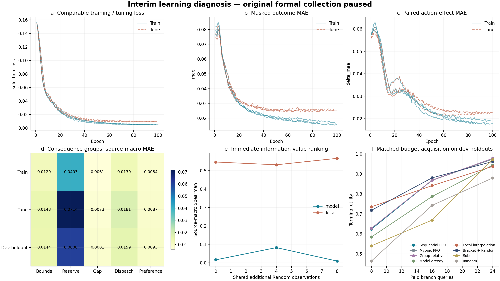
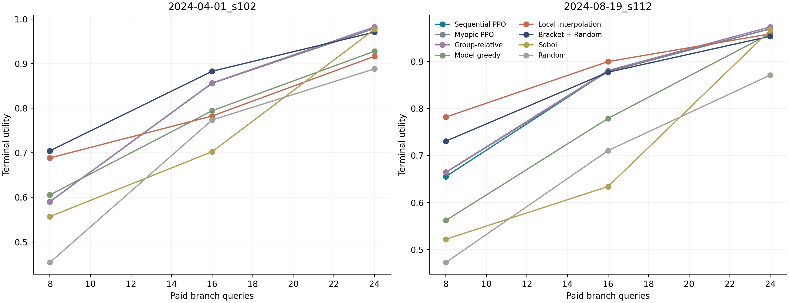

# 暂停采集后的现有样本诊断

原正式采集已按用户要求暂停，7个进程保留。此次只读76个完整情境、2432条分支；原最终confirm未参与。两个开发留出source为2024-04-01_s102与2024-08-19_s112，来自原训练角色；10个source训练、4个source调参、3个source作cal支持检查。该报告回答现有样本能否学会后果和采集价值，不代替最终正式比较。

## 数据支持

| 角色 | source | 情境 | 分支 | 完整后果画像 |
| --- | --- | --- | --- | --- |
| cal | 3 | 12 | 384 | 384 |
| development_test | 2 | 8 | 256 | 256 |
| meta_train | 5 | 20 | 640 | 640 |
| meta_tune | 2 | 8 | 256 | 256 |
| train | 5 | 20 | 640 | 640 |
| tune | 2 | 8 | 256 | 256 |

未知标签保留mask，只有完整核验画像进入终局效用分母；不完整的原confirm池没有被截成更容易的候选池。

## 训练与验证是否匹配

三个seed均使用原136639参数后果模型，监督、学习率、batch和早停保持不变。逐epoch增加无梯度、无随机采样监测；跨训练与调参比较相同无权重口径，原正例加权优化损失单独记录。所有模型仅按原tune/meta_tune角色选择。

| seed | 训练轮数 | best epoch | 训练MAE | 调参MAE | 梯度步数 | 训练秒 | 峰值PyTorch显存MiB |
| --- | --- | --- | --- | --- | --- | --- | --- |
| 42 | 86 | 74 | 0.0167 | 0.0245 | 860 | 12.6 | 27.8 |
| 43 | 98 | 86 | 0.0177 | 0.0255 | 980 | 11.3 | 27.8 |
| 44 | 100 | 94 | 0.0159 | 0.0250 | 1000 | 9.9 | 27.8 |

| 角色 | 后果MAE | 零变化MAE | 行动增量MAE | 零增量MAE | 显著变化方向正确率 |
| --- | --- | --- | --- | --- | --- |
| cal | 0.0266 | 0.0544 | 0.0252 | 0.0562 | 0.8904 |
| development_test | 0.0226 | 0.0531 | 0.0198 | 0.0548 | 0.8972 |
| meta_train | 0.0157 | 0.0527 | 0.0180 | 0.0544 | 0.8926 |
| meta_tune | 0.0255 | 0.0509 | 0.0239 | 0.0525 | 0.8749 |
| train | 0.0178 | 0.0516 | 0.0189 | 0.0533 | 0.9025 |
| tune | 0.0246 | 0.0500 | 0.0205 | 0.0516 | 0.9013 |

行动增量比较同情境候选与参考，双方标签已知才计入。方向指标只统计归一化真实增量绝对值大于0.01的单元，此阈值用于区分有效变化，不是工程报警标准。图a至c比较训练/调参可学习性；图d检查哪类物理后果主导误差。

## 信息价值排序与预算化采集

各模型使用完全相同的公共初始3条和预定Random增量历史，比较预测即时边际效用与已知真实边际效用。原始真值平坦时不报告虚假的Spearman；该排序评价和多步终局规划分别报告。

| 排序器 | Spearman | 有区分度的排序组 | 排序组总数 | Top1边际遗憾 |
| --- | --- | --- | --- | --- |
| model | 0.0355 | 72 | 72 | 0.0838 |
| local | 0.5481 | 72 | 72 | 0.0957 |

| 采集方法 | 预算8效用 | 预算16效用 | 预算24效用 | 预算16边界率 | 预算16未知查询 |
| --- | --- | --- | --- | --- | --- |
| Sequential PPO | 0.6230 | 0.8677 | 0.9739 | 1.0000 | 0.0000 |
| Myopic PPO | 0.6271 | 0.8673 | 0.9738 | 1.0000 | 0.0000 |
| Group-relative | 0.6278 | 0.8686 | 0.9776 | 1.0000 | 0.0000 |
| Model greedy | 0.5839 | 0.7866 | 0.9433 | 0.8333 | 0.0000 |
| Local interpolation | 0.7351 | 0.8410 | 0.9372 | 1.0000 | 0.0000 |
| Bracket + Random | 0.7176 | 0.8799 | 0.9619 | 1.0000 | 0.0000 |
| Sobol | 0.5396 | 0.6683 | 0.9713 | 0.1667 | 0.0000 |
| Random | 0.4636 | 0.7420 | 0.8794 | 0.5000 | 0.0000 |

预算16下，序贯PPO相对即时PPO为+0.0004，相对局部插值为+0.0266，相对括区＋Random为-0.0122，相对Random为+0.1256。各seed、两个开发source及四种时间/偏好情境在相同分母上比较；逐源结果如下。

## 诊断解释与后续容量对照

训练和调参均存在较高误差时，优先核查容量、优化和输入表达；训练误差小而留出误差大时，优先核查跨source经验；后果预测可用而边际价值排序差时，核查后果到采集目标的映射；即时排序可用而PPO不胜强简单方法时，再分析多步规划的实际空间。

本轮使用当前轻量架构建立监测基线，不提前更换正式架构。用户恢复并完成当前正式实验后，容量对照固定数据hash、source、输入、监督和查询预算，先比较小/宽MLP，再对参数量接近的宽MLP与空间时序模型进行比较。结构模型若增加已有历史输入，MLP也应获得同样信息，分别识别容量、结构和信息收益。实际梯度步数、训练时间、显存和独立source表现同时记录。

原采集仍暂停。暂停保留内存态；恢复前须核对pause_state.json中的PID与创建时间，不可重复启动或重复恢复。冻结MPC、容量、阈值、旧RL和预警器均未改动。
